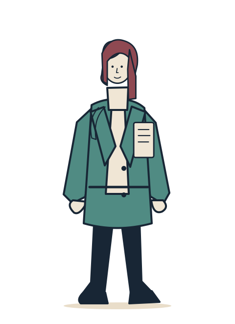
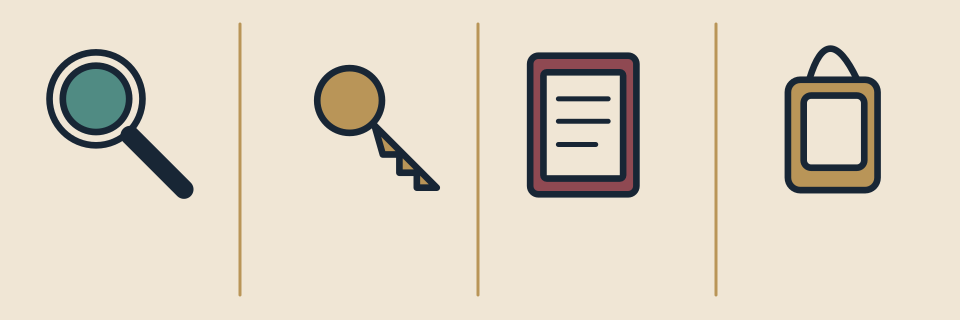
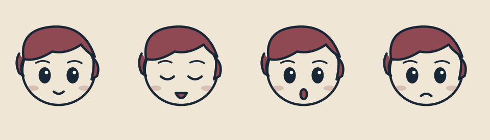

# Dirección artística v0.2.1 — Vector minimalista, NO anime

Estado: **CANDIDATO; revisión visual pendiente.**

Esta revisión **reemplaza** los diseños chibi. La escala de los personajes es humana estilizada (aprox. 6–8 cabezas). Ojos mínimos, rostros sobrios y siluetas legibles; ningún tratamiento manga/anime/chibi.

## Referencias propuestas (archivos vectoriales editables)

## Paleta bloqueada
Tinta `#182635` · papel `#F0E6D5` · latón `#B99558` · burdeos `#8F4952` · jade `#508B83`.

Fondos y objetos se inspiran en la primera referencia visual solicitada (biblioteca cálida, azul oscuro, lámparas, archivos). Los diseños de los personajes son deliberadamente más adultos y esquemáticos.

## Auditoría
La CI verifica seguridad de SVG, formato, gama cromática, manifiesto de estilo y continuidad de inventario. **No puede demostrar mediante reglas que una ilustración esté libre de influencias anime**, por lo que el director de arte debe inspeccionar las capturas y rechazar cualquier rasgo incompatible. Ningún asset puede promoverse a `master/visual` sin aprobación.
